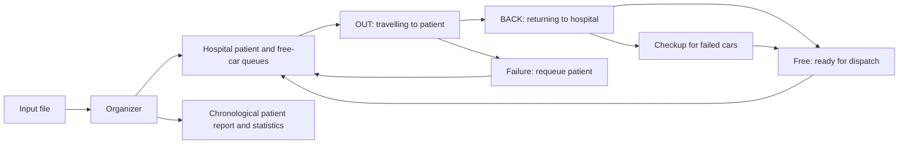

# Ambulance Management System

A C++17 simulation of ambulance dispatch across multiple hospitals. The system models emergency priorities, special-care requirements, request cancellation, ambulance failures, and maintenance, then measures patient waiting times and fleet utilization.

The project demonstrates object-oriented design, custom linked data structures, discrete timestep simulation, resource scheduling, and reproducible testing. It runs as a console application in ordinary Visual Studio, with no third-party application dependencies.

## System Architecture



| Component | Responsibility |
| --- | --- |
| `Organizer` | Loads and validates input, advances the simulation, coordinates dispatch and lifecycle events. |
| `Hospital` | Holds patient queues and free ambulances; assigns compatible cars. |
| `Patients` | Stores request, pickup, completion, cancellation, and severity information. |
| `Car` | Tracks ambulance type, owning hospital, assignment, status, and accumulated busy time. |
| `Output` | Handles the console display and final results report. |
| `LinkedQueue`, `NPQueue` | Provide FIFO queues and cancellation support for normal patients. |
| `priQueue`, `OUTcars` | Order emergency requests and timed car events; support recalling an OUT car. |

Simulation lists use the project's own queues rather than STL containers. The hospital collection and distance matrix use arrays. Queue nodes and patient/car objects have separate ownership so moving an object between lists does not duplicate or destroy it.

## Included Demo

[InputFile.txt](InputFile.txt) contains **3 hospitals, 6 ambulances, 24 patient requests, 5 cancellation records**, and an OUT failure probability of **0.20**. With seed **42**, the verified Microsoft Visual Studio run completes at timestep **105** with **19 served patients, 5 cancellations, and 21 OUT failure events**.

See [the matching report](InputFile-report.txt). To reproduce it, choose `InputFile.txt` at the input prompt, enter a report filename, and use seed `42`.


## Run in ordinary Visual Studio

1. Open **AmbulanceSystem.sln** in Visual Studio 2022 or 2026 with the **Desktop development with C++** workload installed.
2. Select **Debug** and **x64**.
3. Press **Ctrl+F5** to build and run without debugging.
4. Choose interactive or silent mode. Press Enter to accept `testload.txt` and `OutputFile.txt`, or enter other file paths.
5. Enter a random seed, such as `42`, to repeat a run; leave it blank for a different random run.

The project sets the working folder to this source folder, so the default input is found when launched through Visual Studio. The program waits at the end so its result remains visible. Python, CMake, and third-party libraries are not required to run the application.

Interactive mode displays every hospital's EP, SP, NP, and free-car lists, followed by all OUT, BACK, checkup, and finished lists. Entries are object IDs, not memory addresses. **Enter** advances one timestep, **R** completes the run silently, and **Q** stops without writing a final report. A normal completion writes a report and displays served/cancelled/failure counts.

For repeatable command-line runs:

```text
build\x64\Debug\AmbulanceSystem.exe samples\05_failures.txt my-report.txt 42
```

Paths containing spaces must be quoted when passed on the command line. When launching the executable outside Visual Studio, paths are relative to your current working folder. The input and report must be different files.

## Dispatch and Simulation Rules

- EP requests are served before SP and NP, in descending severity. EP uses NC first, then SC.
- SP uses SC only; NP uses NC only. Both wait in first-come, first-served order.
- A car leaves Free, enters OUT, picks up its patient, enters BACK, then returns to its owning hospital.
- Travel takes `ceil(distance / speed)` timesteps. A zero-distance trip finishes immediately.
- NP cancellation removes a waiting request or recalls its OUT car. Already picked-up, finished, unknown, duplicate, and mismatched cancellation requests are ignored. A recalled car takes the time already spent travelling to return.
- Each timestep can fail one randomly selected OUT car. Its patient returns to the front of the appropriate waiting queue, ahead of new arrivals. The car returns over its travelled distance, spends its configured time in checkup, then becomes free.
- An unassigned EP transfers to a hospital with the shortest EP queue, with distance breaking ties. Hospitals with no fleet are excluded. The new trip includes the distance from the destination hospital to the previous hospital. A transferred request waits at its destination to avoid endless transfers and growing travel distances. A failure retry remains at its current hospital.
- The report's `FT PID QT WT` rows are chronological. Waiting time includes travel to pickup. Busy time accumulates across trips, recalls, failures, and checkups; utilization divides average busy time by the final simulation timestep. The transfer percentage counts each emergency patient once. Patient totals include cancelled requests; served and cancelled totals are listed separately.

Scope: the simulation implements OUT-car failures and emergency transfers. BACK-car breakdowns and whole-hospital outages are not modeled.

## Input format

Use plain whitespace-separated values, without comments:

```text
H
SC_speed NC_speed
SC_checkup_time NC_checkup_time
OUT_failure_probability
H rows of H hospital distances
H rows of SC_count NC_count
R
R patient records
C
C cancellation records
```

Patient records are `NP QT PID HID DST`, `SP QT PID HID DST`, or `EP QT PID HID DST SVR`. Cancellation records are `CT PID HID`.

Times start at 1, patient IDs must be unique, hospital IDs range from 1 to H, requests must be sorted by request time, speeds are positive, and probability ranges from 0 to 1. Distances and checkup durations may be zero. Cancellations need not be sorted. An NP with no compatible car is accepted if it has a valid future cancellation; other impossible fleets are rejected with a readable error. A ten-million-timestep guard stops pathological nonterminating failure configurations without producing a misleading final report.

## Six supplied scenarios

Each input in `samples` has a matching `.out.txt` report generated with seed **42**:

| Input | Coverage |
| --- | --- |
| `01_priority.txt` | Emergency severity, NC/SC fallback, SP/NP waiting |
| `02_cancellations.txt` | Waiting cancellation, OUT recall, cancellation after pickup |
| `03_transfer.txt` | Multiple emergency transfers and distance tie-breaking |
| `04_rounding.txt` | Partial travel timesteps, zero distance, reuse of returned cars |
| `05_failures.txt` | OUT failures, retry priority, checkup, repeated trips |
| `06_multi_hospital.txt` | Mixed requests across hospitals with cancellations and failures |

## Verification

Both Microsoft Visual Studio and GCC builds are checked. The black-box checks assert exact timings for the deterministic scenarios, retry precedence, checkup release, transfer backlog selection, cancellation-only workloads, input errors, unique completion, sorted output, menu validation, and input-file protection.

If Python is installed, run from this folder:

```text
python tests\verify.py build\x64\Debug\AmbulanceSystem.exe
```

This regenerates the six sample reports with seed 42. Random scenarios are repeatable with the same executable/runtime and seed; exact random sequences can differ between C++ library implementations.

## Build with CMake

Run from this folder:

```powershell
cmake -S . -B build-cmake
cmake --build build-cmake --config Release
```

On Visual Studio generators, the executable is `build-cmake/Release/AmbulanceSystem.exe`; single-configuration generators typically place it directly in `build-cmake`.

## Project Files

```text
Ambulance_Management_System/
  AmbulanceSystem.sln       Visual Studio solution
  AmbulanceSystem.vcxproj   C++17 console project
  CMakeLists.txt            Alternative CMake build
  Source.cpp               Entry point, mode and file selection
  Organizer.*              Simulation lifecycle
  Hospital.*               Hospital queues and assignment
  Car.* / Patients.*       Domain objects
  Output.*                 Console interface and reporting
  LinkedQueue.h            Custom FIFO queue
  NPQueue.h                Normal-patient cancellation queue
  priQueue.h / OUTcars.h    Priority events and outbound cars
  testload.txt             Default workload
  InputFile.txt            Mixed demonstration workload
  InputFile-report.txt     Demonstration results with seed 42
  samples/                 Six scenario inputs and matching reports
  tests/verify.py           Regression checks
```

Build products, local editor settings, and generated default reports are excluded from version control.
